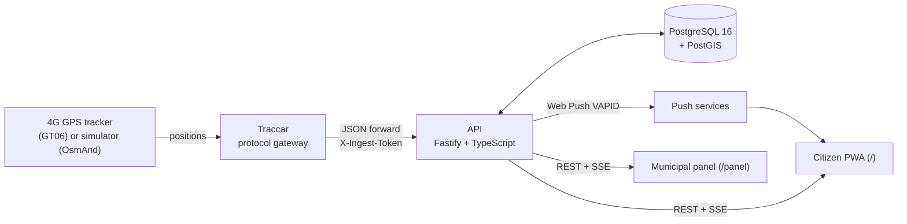

# Ruta Limpia

Pilot system for the municipal waste-collection service in Independencia and Huaraz (Áncash, Peru). It
tracks the collection truck with a GPS tracker, estimates when it reaches each public reference point
(ETA), and sends proximity alerts to the households subscribed to that point. A municipal panel monitors
the route. The system also records the field instruments and computes the pilot's impact indicators.

The requirements come from the project proposal `Proyecto_RSU_Ruta_Limpia_2026.pdf`.

## Architecture



- **Traccar** decodes the tracker protocols and forwards every position as JSON
  (`{ "position": {...}, "device": {...} }`, speed in knots) to `POST /ingest/traccar/positions`. It
  authenticates with the shared secret header `X-Ingest-Token`.
- **API** (`apps/api`) uses a hexagonal architecture organized by bounded context: `routes`, `tracking`,
  `eta`, `alerts`, `field`, `indicators`, `auth`. See [`apps/api/src/README.md`](apps/api/src/README.md).
- **Web** (`apps/web`) is a React app with two areas: the citizen view (`/`) and the municipal panel
  (`/panel`).

## Prerequisites

- Node.js 22 (see `.nvmrc`) and pnpm 10 (`corepack enable` picks the version pinned in `package.json`).
- Docker with Docker Compose v2.

## Setup

```bash
cp .env.example .env    # then set a real INGEST_TOKEN: openssl rand -hex 32
pnpm install
pnpm infra:up           # PostGIS on :5432, Traccar on :8082 (UI), :5055 (OsmAnd), :5023 (GT06)
pnpm --filter api db:migrate   # optional: the API also migrates on start (MIGRATE_ON_START)
pnpm --filter api db:seed      # route RI-01 with P01–P15, truck UNIDAD-A, sample schedule
pnpm dev                # API on http://localhost:3000, web on http://localhost:5173
```

The API requires an `INGEST_TOKEN` of at least 32 characters and refuses to start otherwise, so a short
placeholder must be replaced with a real secret generated by `openssl rand -hex 32`.

Check the API with `curl http://localhost:3000/health`. Open the Traccar UI at http://localhost:8082. The
first account you register there becomes the administrator. Register each tracker as a device, using its
IMEI or simulator ID as the identifier.

### Local infrastructure notes

- `infra/docker-compose.yml` reads the root `.env` through `env_file`, so the file must exist before
  `docker compose -f infra/docker-compose.yml up -d`.
- Traccar stores its own data in a separate `traccar` database on the same PostGIS server. The database is
  created by `infra/db/init/` the first time the data volume starts. To recreate it, run
  `docker compose -f infra/docker-compose.yml down -v`. This deletes all local data.
- Traccar does not expand `${VAR}` placeholders in `traccar.xml`. It can read each setting from an
  environment variable named after the key (`forward.url` → `FORWARD_URL`) when
  `CONFIG_USE_ENVIRONMENT_VARIABLES=true`. `infra/traccar/entrypoint.sh` builds those variables (database,
  `FORWARD_URL`, `FORWARD_HEADER=X-Ingest-Token: <INGEST_TOKEN>`) from `.env`. It then starts Traccar with
  a clean environment, so unrelated variables such as the API's `DATABASE_URL` cannot leak into Traccar.
- By default, Traccar forwards to the API on the host
  (`http://host.docker.internal:3000/ingest/traccar/positions`). Change `TRACCAR_FORWARD_URL` when the API
  runs elsewhere, for example `http://api:3000/...` inside the same compose project.
- The official PostGIS image is published only for amd64. On Apple Silicon it runs under emulation.

### Configuration

The API reads its configuration from the environment (the root `.env` in development) and fails fast on
invalid values. An empty value (`PORT=`) counts as unset, so the default applies.

| Variable                             | Default                | Description                                                                      |
| ------------------------------------ | ---------------------- | -------------------------------------------------------------------------------- |
| `DATABASE_URL`                       | required               | PostgreSQL URL (`postgres://…`).                                                 |
| `INGEST_TOKEN`                       | required (≥ 32 chars)  | Shared secret Traccar sends in `X-Ingest-Token`.                                 |
| `HOST` / `PORT`                      | `0.0.0.0` / `3000`     | HTTP listener.                                                                   |
| `LOG_LEVEL`                          | `info`                 | Pino log level.                                                                  |
| `DATABASE_POOL_MAX`                  | `10`                   | Maximum pg pool connections.                                                     |
| `MIGRATE_ON_START`                   | `true`                 | Apply pending migrations when the API starts.                                    |
| `TRIP_START_ZONE_METERS`             | `150`                  | A trip auto-starts when a fix lies this close to the route start.                |
| `TRIP_INACTIVITY_TIMEOUT_SEC`        | `1800`                 | An active trip without fixes for this long is aborted.                           |
| `TRIP_INACTIVITY_CHECK_INTERVAL_SEC` | `60`                   | How often the inactivity job runs.                                               |
| `ETA_REFRESH_INTERVAL_SEC`           | `15`                   | How often the ETAs of active trips are recomputed and republished between fixes. |
| `SHUTDOWN_TIMEOUT_SEC`               | `10`                   | Graceful-shutdown deadline before the process is forced to exit.                 |
| `SEED_VEHICLE_UNIQUE_ID`             | `ruta-limpia-unidad-a` | Traccar identifier given to UNIDAD-A by `db:seed`.                               |
| `TRUST_PROXY`                        | `false`                | Trust `X-Forwarded-*` from the reverse proxy (real client IPs).                  |
| `PUBLIC_RATE_LIMIT_PER_MINUTE`       | `20`                   | Requests per client IP and route on the public mutating routes.                  |
| `VAPID_PUBLIC_KEY`                   | unset                  | Web Push public key (87 chars). Set all three VAPID vars or none.                |
| `VAPID_PRIVATE_KEY`                  | unset                  | Web Push private key (43 chars). Keep it secret.                                 |
| `VAPID_SUBJECT`                      | unset                  | Contact for the push services: `mailto:…` or `https://…`.                        |
| `PUSH_CONCURRENCY`                   | `8`                    | Pushes sent at the same time for one alert.                                      |
| `PUSH_MAX_CONSECUTIVE_FAILURES`      | `5`                    | Failed pushes in a row before a subscription is revoked.                         |

### Position ingestion

`POST /ingest/traccar/positions` receives Traccar's JSON forward (`{ position, device }`, speed in knots).

| Response | When                                                                                      |
| -------- | ----------------------------------------------------------------------------------------- |
| `401`    | `X-Ingest-Token` is missing or wrong (constant-time comparison, checked before the body). |
| `400`    | The payload is malformed.                                                                 |
| `202`    | The device `uniqueId` is not a registered vehicle: accepted and logged, never retried.    |
| `200`    | Processed, or a replay of an already stored Traccar position (idempotent no-op).          |
| `5xx`    | Processing failed; Traccar retries the forward.                                           |

Each accepted position runs the tracking pipeline: it is stored, the vehicle's trip is found or auto-started
(on its default route, within the start zone), passes and completion are detected, ETAs are estimated, and
at most one proximity alert per trip and point is recorded. The `instrument1_route_log` view is the
Instrument 1 route log: one row per reference point of every trip, with the alert time and communicated ETA
only when an alert was actually sent.

### Web Push subscriptions

Households follow one public reference point (for example `P08`) and receive proximity alerts as Web
Push notifications. There is no SMS or WhatsApp channel.

Generate the VAPID keys once per deployment and add the printed lines to `.env`:

```bash
pnpm --filter api vapid:generate mailto:soporte@municipalidad.example
```

Changing the keys invalidates every existing browser subscription. Without VAPID keys the API still
starts: it logs a warning, the subscription endpoints answer `503`, and alerts are only logged.

| Endpoint                         | Description                                                                                  |
| -------------------------------- | -------------------------------------------------------------------------------------------- |
| `GET /api/push/vapid-public-key` | `{ publicKey }` for `pushManager.subscribe()`.                                               |
| `POST /api/subscriptions`        | Subscribe to a point (`201 { subscriptionId, managementToken, point }`). See the body below. |
| `DELETE /api/subscriptions/:id`  | Cancel with `Authorization: Bearer <managementToken>` (`204`; `401`/`403`/`404`).            |

The `POST /api/subscriptions` body is `{ subscription, pointCode | pointId, routeCode?, householdCode?,
consent: true, consentVersion }`, where `subscription` is the browser's `PushSubscription.toJSON()`.

- `consent` must be `true` (`400 consent_required` otherwise). The API records the consent time and the
  version of the consent text.
- An unknown point or household, a point code that exists on several routes without `routeCode`, or an
  endpoint outside the browser push services (FCM, Mozilla, Apple, Windows) answers `422`.
- With `householdCode`, the point must be on the household's route (`422 household_route_mismatch`
  otherwise). Another point of the same route is allowed, for example one on the way to work.
- Subscribing the same browser endpoint again moves it to the new point, reactivates it, and issues a new
  management token. The old token stops working, also for a cancel that raced the re-subscription.
- The mutating routes are rate-limited per client IP (`PUBLIC_RATE_LIMIT_PER_MINUTE`, `429` beyond).

Each new proximity alert is pushed, after the tracking transaction commits and in the background (it
never delays or fails the ingest), to every active subscription of its point. The payload is JSON:
`{ type: 'proximity_alert', alertId, subscriptionId, pointCode, pointName, predictedPassAt,
secondsRemaining, url: '/?p=<code>', title, body }`, with Spanish copy such as "El camión recolector
pasará por P08 en ~8 min (aprox. 17:38). Saca tus residuos en bolsas cerradas." (time in America/Lima).
Pushes use `urgency: high`, a TTL until the predicted pass (at least 60 s), and one topic per point.

- Every push is logged in `alert_deliveries` (`sent`, `failed` or `expired`, HTTP status, time), and the
  alert's `recipients_count`, `delivered_count` and `failed_count` are updated.
- A `404`/`410` answer means the browser dropped the subscription: it is revoked as `expired`. Other
  errors count as failures; after `PUSH_MAX_CONSECUTIVE_FAILURES` in a row it is revoked
  (`too_many_failures`). A success resets the streak.
- The service worker confirms reception with `POST /api/alerts/:alertId/receipts`, which sets
  `received_at` once ("recepción confirmada cuando sea técnicamente posible"). Its per-IP limit is ten
  times `PUBLIC_RATE_LIMIT_PER_MINUTE`, because a whole point receives an alert at once, often behind
  one carrier NAT address.

Privacy: the API never stores an address, a name or a phone number. A household is a code from its
sticker plus a public reference point. A subscription stores the push endpoint and keys, the point, the
optional household, the consent, and the SHA-256 hash of its management token (the token is shown only
once, to the browser). Cancelling is a soft delete (`revoked_at`, `revoke_reason = user_cancelled`), kept
for the indicators.

### Public read API

The citizen PWA and the municipal panel read the route catalog and the live state from these public
endpoints (no authentication, no personal data). Route codes are case-insensitive. An unknown or
inactive route answers `404 { error: "route_not_found" }`, a malformed code `400`.

| Endpoint                     | Cache-Control         | Description                                                                        |
| ---------------------------- | --------------------- | ---------------------------------------------------------------------------------- |
| `GET /api/routes`            | `public, max-age=300` | Active routes: `{ routes: [{ code, name, district, lengthMeters, pointCount }] }`. |
| `GET /api/routes/:code`      | `public, max-age=300` | Route detail: geometry, reference points, weekly schedule.                         |
| `GET /api/live/routes/:code` | `no-store`            | Live snapshot: active trips, truck, signal, ETAs, passes, alerts.                  |

Route detail (`GET /api/routes/RI-01`):

```jsonc
{
  "code": "RI-01", "name": "Av. Centenario – Independencia", "district": "Independencia",
  "lengthMeters": 1285.8, "pointCount": 15, "timeZone": "America/Lima",
  "geometry": { "type": "LineString", "coordinates": [[-77.52855, -9.523468], ...] }, // [lon, lat]
  "points": [
    { "code": "P01", "name": "…", "sequence": 1, "lat": -9.523207, "lon": -77.528621,
      "chainageMeters": 30, "observesMusic": false }
  ],
  "schedule": [{ "weekday": 1, "plannedStart": "07:00" }] // 0 = Sunday … 6 = Saturday, local time
}
```

Live snapshot (`GET /api/live/routes/RI-01`). `trips` is empty when no truck runs the route (show the
printed schedule); it holds one entry per active trip otherwise:

```jsonc
{
  "route": { "code": "RI-01", "name": "…" },
  "generatedAt": "2026-10-20T12:15:01.000Z",
  "staleAfterSeconds": 60,
  "trips": [
    {
      "tripId": "…",
      "startedAt": "…",
      "startMode": "auto",
      "vehicle": { "code": "UNIDAD-A", "label": "Unidad A (compactadora)" },
      "signal": "live", // live | stale (no fix for 60 s) | none (no fix yet)
      "lastFixAt": "…",
      "lastPosition": { "lat": -9.52, "lon": -77.53, "fixTime": "…" },
      "progress": { "chainageMeters": 412.5, "percent": 31.2, "offRoute": false },
      "etas": [
        { "pointId": "…", "pointCode": "P01", "status": "passed" },
        {
          "pointId": "…",
          "pointCode": "P08",
          "status": "live",
          "predictedPassAt": "…",
          "secondsRemaining": 600,
          "window": { "minMinutes": 8, "maxMinutes": 12 },
        },
        { "pointId": "…", "pointCode": "P09", "status": "stale" }, // never a prediction
      ],
      "passes": [
        { "pointId": "…", "pointCode": "P01", "passedAt": "…", "precision": "interpolated" },
      ],
      "alerts": [
        {
          "pointId": "…",
          "pointCode": "P05",
          "emittedAt": "…",
          "communicatedPredictedPassAt": "…",
          "recipients": 12,
          "delivered": 11,
        },
      ],
    },
  ],
}
```

- ETAs are recomputed at request time from the persisted trip state, so a truck that stopped
  reporting turns `stale` without a new fix. A background job does the same every
  `ETA_REFRESH_INTERVAL_SEC` for every active trip and publishes it as `eta.updated`; it never
  emits alerts (alerts only fire on fresh fixes during ingestion). `status` is `live`, `stale`, `passed` or `not_started`
  (trip started, no on-route fix yet). Only `live` entries have `predictedPassAt`,
  `secondsRemaining` and `window`.
- `window` is the arrival range shown to citizens ("Llegada estimada: 8 a 12 minutos"): the
  remaining time ±max(1 min, 20 %), in whole minutes.
- `alerts` holds the alert of each point in the current trip (at most one per point) with its push
  delivery counts.

## Scripts

| Command                              | Description                                                                  |
| ------------------------------------ | ---------------------------------------------------------------------------- |
| `pnpm dev`                           | Run the API (tsx watch) and the web app (Vite).                              |
| `pnpm build`                         | Build every app (`tsc` for the API, Vite for web).                           |
| `pnpm typecheck`                     | Type-check every package.                                                    |
| `pnpm lint`                          | ESLint (typescript-eslint, type-aware) on the repo.                          |
| `pnpm test`                          | Run every Vitest project (`api`, `api-integration`, `web`). Docker required. |
| `pnpm --filter api test:unit`        | API unit tests only (no Docker).                                             |
| `pnpm --filter api test:integration` | API integration tests against PostGIS (Testcontainers).                      |
| `pnpm --filter api db:migrate`       | Apply pending database migrations.                                           |
| `pnpm --filter api db:seed`          | Load the pilot catalog (idempotent).                                         |
| `pnpm --filter api vapid:generate`   | Print a new VAPID key pair as `.env` lines.                                  |
| `pnpm format` / `format:check`       | Format with Prettier, or check the formatting.                               |
| `pnpm infra:up` / `down` / `logs`    | Manage the local Docker infrastructure.                                      |

Integration tests start a `postgis/postgis:16-3.5` container pinned to `linux/amd64` (the only published
platform; Apple Silicon runs it emulated). Set `TEST_DATABASE_URL` to use an existing disposable database
instead.

## Repository layout

```text
apps/
  api/          Fastify API: src/<context>/{domain,application,infrastructure}, shared/, main.ts, config.ts
  web/          Vite + React app: citizen area (/) and municipal panel (/panel)
infra/
  docker-compose.yml   Local PostGIS + Traccar
  db/init/             Database initialization scripts
  traccar/             traccar.xml and the entrypoint wrapper
odd/tasks/      Feature plan and progress
```
