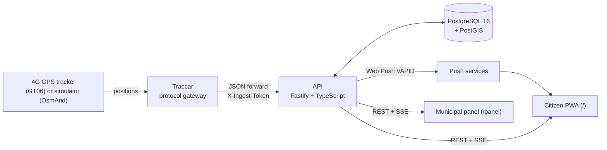

# Ruta Limpia

Pilot system for the municipal waste-collection service in Independencia and Huaraz (Áncash, Peru). It
tracks the collection truck with a GPS tracker, estimates when it reaches each public reference point
(ETA), and sends proximity alerts to the households subscribed to that point. A municipal panel monitors
the route. The system also records the field instruments and computes the pilot's impact indicators.

The requirements come from the project proposal `Proyecto_RSU_Ruta_Limpia_2026.pdf`.

## Architecture



- **Traccar** decodes the tracker protocols and forwards every position as JSON
  (`{ "position": {...}, "device": {...} }`, speed in knots) to `POST /ingest/traccar/positions`. It
  authenticates with the shared secret header `X-Ingest-Token`.
- **API** (`apps/api`) uses a hexagonal architecture organized by bounded context: `routes`, `tracking`,
  `eta`, `alerts`, `field`, `indicators`, `auth`. See [`apps/api/src/README.md`](apps/api/src/README.md).
- **Web** (`apps/web`) is a React app with two areas: the citizen view (`/`) and the municipal panel
  (`/panel`).

## Prerequisites

- Node.js 22 (see `.nvmrc`) and pnpm 10 (`corepack enable` picks the version pinned in `package.json`).
- Docker with Docker Compose v2.

## Setup

```bash
cp .env.example .env    # then set a real INGEST_TOKEN: openssl rand -hex 32
pnpm install
pnpm infra:up           # PostGIS on :5432, Traccar on :8082 (UI), :5055 (OsmAnd), :5023 (GT06)
pnpm --filter api db:migrate   # optional: the API also migrates on start (MIGRATE_ON_START)
pnpm --filter api db:seed      # route RI-01 with P01–P15, truck UNIDAD-A, sample schedule
pnpm dev                # API on http://localhost:3000, web on http://localhost:5173
```

The API requires an `INGEST_TOKEN` of at least 32 characters and refuses to start otherwise, so a short
placeholder must be replaced with a real secret generated by `openssl rand -hex 32`.

Check the API with `curl http://localhost:3000/health`. Open the Traccar UI at http://localhost:8082. The
first account you register there becomes the administrator. Register each tracker as a device, using its
IMEI or simulator ID as the identifier.

### Local infrastructure notes

- `infra/docker-compose.yml` reads the root `.env` through `env_file`, so the file must exist before
  `docker compose -f infra/docker-compose.yml up -d`.
- Traccar stores its own data in a separate `traccar` database on the same PostGIS server. The database is
  created by `infra/db/init/` the first time the data volume starts. To recreate it, run
  `docker compose -f infra/docker-compose.yml down -v`. This deletes all local data.
- Traccar does not expand `${VAR}` placeholders in `traccar.xml`. It can read each setting from an
  environment variable named after the key (`forward.url` → `FORWARD_URL`) when
  `CONFIG_USE_ENVIRONMENT_VARIABLES=true`. `infra/traccar/entrypoint.sh` builds those variables (database,
  `FORWARD_URL`, `FORWARD_HEADER=X-Ingest-Token: <INGEST_TOKEN>`) from `.env`. It then starts Traccar with
  a clean environment, so unrelated variables such as the API's `DATABASE_URL` cannot leak into Traccar.
- By default, Traccar forwards to the API on the host
  (`http://host.docker.internal:3000/ingest/traccar/positions`). Change `TRACCAR_FORWARD_URL` when the API
  runs elsewhere, for example `http://api:3000/...` inside the same compose project.
- The official PostGIS image is published only for amd64. On Apple Silicon it runs under emulation.

### Configuration

The API reads its configuration from the environment (the root `.env` in development) and fails fast on
invalid values.

| Variable                             | Default                | Description                                                       |
| ------------------------------------ | ---------------------- | ----------------------------------------------------------------- |
| `DATABASE_URL`                       | required               | PostgreSQL URL (`postgres://…`).                                  |
| `INGEST_TOKEN`                       | required (≥ 32 chars)  | Shared secret Traccar sends in `X-Ingest-Token`.                  |
| `HOST` / `PORT`                      | `0.0.0.0` / `3000`     | HTTP listener.                                                    |
| `LOG_LEVEL`                          | `info`                 | Pino log level.                                                   |
| `DATABASE_POOL_MAX`                  | `10`                   | Maximum pg pool connections.                                      |
| `MIGRATE_ON_START`                   | `true`                 | Apply pending migrations when the API starts.                     |
| `TRIP_START_ZONE_METERS`             | `150`                  | A trip auto-starts when a fix lies this close to the route start. |
| `TRIP_INACTIVITY_TIMEOUT_SEC`        | `1800`                 | An active trip without fixes for this long is aborted.            |
| `TRIP_INACTIVITY_CHECK_INTERVAL_SEC` | `60`                   | How often the inactivity job runs.                                |
| `SHUTDOWN_TIMEOUT_SEC`               | `10`                   | Graceful-shutdown deadline before the process is forced to exit.  |
| `SEED_VEHICLE_UNIQUE_ID`             | `ruta-limpia-unidad-a` | Traccar identifier given to UNIDAD-A by `db:seed`.                |

### Position ingestion

`POST /ingest/traccar/positions` receives Traccar's JSON forward (`{ position, device }`, speed in knots).

| Response | When                                                                                      |
| -------- | ----------------------------------------------------------------------------------------- |
| `401`    | `X-Ingest-Token` is missing or wrong (constant-time comparison, checked before the body). |
| `400`    | The payload is malformed.                                                                 |
| `202`    | The device `uniqueId` is not a registered vehicle: accepted and logged, never retried.    |
| `200`    | Processed, or a replay of an already stored Traccar position (idempotent no-op).          |
| `5xx`    | Processing failed; Traccar retries the forward.                                           |

Each accepted position runs the tracking pipeline: it is stored, the vehicle's trip is found or auto-started
(on its default route, within the start zone), passes and completion are detected, ETAs are estimated, and
at most one proximity alert per trip and point is recorded. The `instrument1_route_log` view is the
Instrument 1 route log: one row per reference point of every trip, with the alert time and communicated ETA
only when an alert was actually sent.

## Scripts

| Command                              | Description                                                                  |
| ------------------------------------ | ---------------------------------------------------------------------------- |
| `pnpm dev`                           | Run the API (tsx watch) and the web app (Vite).                              |
| `pnpm build`                         | Build every app (`tsc` for the API, Vite for web).                           |
| `pnpm typecheck`                     | Type-check every package.                                                    |
| `pnpm lint`                          | ESLint (typescript-eslint, type-aware) on the repo.                          |
| `pnpm test`                          | Run every Vitest project (`api`, `api-integration`, `web`). Docker required. |
| `pnpm --filter api test:unit`        | API unit tests only (no Docker).                                             |
| `pnpm --filter api test:integration` | API integration tests against PostGIS (Testcontainers).                      |
| `pnpm --filter api db:migrate`       | Apply pending database migrations.                                           |
| `pnpm --filter api db:seed`          | Load the pilot catalog (idempotent).                                         |
| `pnpm format` / `format:check`       | Format with Prettier, or check the formatting.                               |
| `pnpm infra:up` / `down` / `logs`    | Manage the local Docker infrastructure.                                      |

Integration tests start a `postgis/postgis:16-3.5` container pinned to `linux/amd64` (the only published
platform; Apple Silicon runs it emulated). Set `TEST_DATABASE_URL` to use an existing disposable database
instead.

## Repository layout

```text
apps/
  api/          Fastify API: src/<context>/{domain,application,infrastructure}, shared/, main.ts, config.ts
  web/          Vite + React app: citizen area (/) and municipal panel (/panel)
infra/
  docker-compose.yml   Local PostGIS + Traccar
  db/init/             Database initialization scripts
  traccar/             traccar.xml and the entrypoint wrapper
odd/tasks/      Feature plan and progress
```
