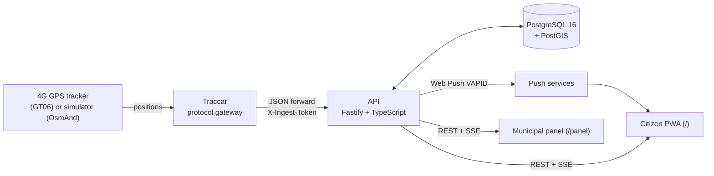

# Ruta Limpia

Pilot system for the municipal waste-collection service in Independencia and Huaraz (Áncash, Peru). It
tracks the collection truck with a GPS tracker, estimates when it reaches each public reference point
(ETA), and sends proximity alerts to the households subscribed to that point. A municipal panel monitors
the route. The system also records the field instruments and computes the pilot's impact indicators.

The requirements come from the project proposal `Proyecto_RSU_Ruta_Limpia_2026.pdf`.

## Architecture



- **Traccar** decodes the tracker protocols and forwards every position as JSON
  (`{ "position": {...}, "device": {...} }`, speed in knots) to `POST /ingest/traccar/positions`. It
  authenticates with the shared secret header `X-Ingest-Token`.
- **API** (`apps/api`) uses a hexagonal architecture organized by bounded context: `routes`, `tracking`,
  `eta`, `alerts`, `field`, `indicators`, `auth`. See [`apps/api/src/README.md`](apps/api/src/README.md).
- **Web** (`apps/web`) is a React app with two areas: the citizen view (`/`) and the municipal panel
  (`/panel`).

## Prerequisites

- Node.js 22 (see `.nvmrc`) and pnpm 10 (`corepack enable` picks the version pinned in `package.json`).
- Docker with Docker Compose v2.

## Setup

```bash
cp .env.example .env    # then set a real INGEST_TOKEN: openssl rand -hex 32
pnpm install
pnpm infra:up           # PostGIS on :5432, Traccar on :8082 (UI), :5055 (OsmAnd), :5023 (GT06)
pnpm --filter api db:migrate   # optional: the API also migrates on start (MIGRATE_ON_START)
pnpm --filter api db:seed      # route RI-01 with P01–P15, truck UNIDAD-A, sample schedule
pnpm dev                # API on http://localhost:3000, web on http://localhost:5173
```

The API requires an `INGEST_TOKEN` of at least 32 characters and refuses to start otherwise, so a short
placeholder must be replaced with a real secret generated by `openssl rand -hex 32`.

Check the API with `curl http://localhost:3000/health`. Open the Traccar UI at http://localhost:8082. The
first account you register there becomes the administrator. Register each tracker as a device, using its
IMEI or simulator ID as the identifier. For the simulated truck, `pnpm sim:bootstrap` does both (see
[`docs/simulator.md`](docs/simulator.md)), and `pnpm sim:drive` drives RI-01.

### Local infrastructure notes

- `infra/docker-compose.yml` reads the root `.env` through `env_file`, so the file must exist before
  `docker compose -f infra/docker-compose.yml up -d`.
- Traccar stores its own data in a separate `traccar` database on the same PostGIS server. The database is
  created by `infra/db/init/` the first time the data volume starts. To recreate it, run
  `docker compose -f infra/docker-compose.yml down -v`. This deletes all local data.
- Traccar does not expand `${VAR}` placeholders in `traccar.xml`. It can read each setting from an
  environment variable named after the key (`forward.url` → `FORWARD_URL`) when
  `CONFIG_USE_ENVIRONMENT_VARIABLES=true`. `infra/traccar/entrypoint.sh` builds those variables (database,
  `FORWARD_URL`, `FORWARD_HEADER=X-Ingest-Token: <INGEST_TOKEN>`) from `.env`. It then starts Traccar with
  a clean environment, so unrelated variables such as the API's `DATABASE_URL` cannot leak into Traccar.
- Each compose file sets where Traccar forwards (`TRACCAR_FORWARD_URL`): the API on the host in
  `infra/docker-compose.yml`, `http://api:3000/...` in production (`infra/prod/`). The entrypoint has
  no fallback for it, so a missing value stops Traccar with a clear error instead of forwarding to a
  wrong place. The JVM memory (`TRACCAR_JAVA_OPTS`) defaults only in the entrypoint.
- The official PostGIS image is published only for amd64. On Apple Silicon it runs under emulation.

### Configuration

The API reads its configuration from the environment (the root `.env` in development) and fails fast on
invalid values. An empty value (`PORT=`) counts as unset, so the default applies.

| Variable                             | Default                | Description                                                                      |
| ------------------------------------ | ---------------------- | -------------------------------------------------------------------------------- |
| `DATABASE_URL`                       | required               | PostgreSQL URL (`postgres://…`).                                                 |
| `INGEST_TOKEN`                       | required (≥ 32 chars)  | Shared secret Traccar sends in `X-Ingest-Token`.                                 |
| `HOST` / `PORT`                      | `0.0.0.0` / `3000`     | HTTP listener.                                                                   |
| `LOG_LEVEL`                          | `info`                 | Pino log level.                                                                  |
| `DATABASE_POOL_MAX`                  | `10`                   | Maximum pg pool connections.                                                     |
| `MIGRATE_ON_START`                   | `true`                 | Apply pending migrations when the API starts.                                    |
| `TRIP_START_ZONE_METERS`             | `150`                  | A trip auto-starts when a fix lies this close to the route start.                |
| `TRIP_INACTIVITY_TIMEOUT_SEC`        | `1800`                 | An active trip without fixes for this long is aborted.                           |
| `TRIP_INACTIVITY_CHECK_INTERVAL_SEC` | `60`                   | How often the inactivity job runs.                                               |
| `ETA_REFRESH_INTERVAL_SEC`           | `15`                   | How often the ETAs of active trips are recomputed and republished between fixes. |
| `SSE_MAX_CONNECTIONS`                | `500`                  | Open live streams (SSE) across all routes; more answer `503`.                    |
| `MAX_FIX_FUTURE_SKEW_SEC`            | `120`                  | A fix dated more than this ahead of the server clock is ignored (`202`).         |
| `SHUTDOWN_TIMEOUT_SEC`               | `10`                   | Graceful-shutdown deadline before the process is forced to exit.                 |
| `SEED_VEHICLE_UNIQUE_ID`             | `ruta-limpia-unidad-a` | Traccar identifier given to UNIDAD-A by `db:seed`.                               |
| `TRUST_PROXY`                        | `false`                | Trust `X-Forwarded-*` from the reverse proxy (real client IPs).                  |
| `PUBLIC_RATE_LIMIT_PER_MINUTE`       | `20`                   | Requests per client IP and route on the public mutating routes.                  |
| `VAPID_PUBLIC_KEY`                   | unset                  | Web Push public key (87 chars). Set all three VAPID vars or none.                |
| `VAPID_PRIVATE_KEY`                  | unset                  | Web Push private key (43 chars). Keep it secret.                                 |
| `VAPID_SUBJECT`                      | unset                  | Contact for the push services: `mailto:…` or `https://…`.                        |
| `SESSION_COOKIE_SECURE`              | `true`                 | `Secure` flag of the panel cookie. Set `false` only for plain-HTTP development.  |
| `SESSION_IDLE_MINUTES`               | `480`                  | A panel session ends after this long without requests.                           |
| `SESSION_ABSOLUTE_HOURS`             | `168`                  | A panel session ends this long after login, however active.                      |
| `LOGIN_RATE_LIMIT_PER_MINUTE`        | `10`                   | Panel login attempts per client IP and minute.                                   |
| `PUBLIC_ORIGIN`                      | unset                  | Public origin of the web app (`https://…`): panel CSRF check and sticker links.  |
| `PUSH_CONCURRENCY`                   | `8`                    | Pushes sent at the same time for one alert.                                      |
| `PUSH_MAX_CONSECUTIVE_FAILURES`      | `5`                    | Failed pushes in a row before a subscription is revoked.                         |

### Position ingestion

`POST /ingest/traccar/positions` receives Traccar's JSON forward (`{ position, device }`, speed in knots).

| Response | When                                                                                                                                          |
| -------- | --------------------------------------------------------------------------------------------------------------------------------------------- |
| `401`    | `X-Ingest-Token` is missing or wrong (constant-time comparison, checked before the body).                                                     |
| `400`    | The payload is malformed.                                                                                                                     |
| `202`    | The device `uniqueId` is not a registered vehicle: accepted and logged, never retried.                                                        |
| `202`    | The fix is dated more than `MAX_FIX_FUTURE_SKEW_SEC` ahead of the server clock: logged, never stored, never retried (`reason: "future_fix"`). |
| `200`    | Processed, or a replay of an already stored position, by Traccar id or by vehicle and fix time (idempotent no-op).                            |
| `5xx`    | Processing failed; Traccar retries the forward.                                                                                               |

Traccar 6.16 forwards a position before storing it, so the forward may carry `id: 0`: such a position is
stored without a Traccar id, and a replay is recognized by the vehicle and the fix time (migration
`0015-positions-without-traccar-id`; the end-to-end smoke test caught it, see
[`docs/simulator.md`](docs/simulator.md)).

Each accepted position runs the tracking pipeline: it is stored, the vehicle's trip is found or auto-started
(on its default route, within the start zone), passes and completion are detected, ETAs are estimated, and
at most one proximity alert per trip and point is recorded. The `instrument1_route_log` view is the
Instrument 1 route log: one row per reference point of every trip, with the alert time and communicated ETA
only when an alert was actually sent.

### Web Push subscriptions

Households follow one public reference point (for example `P08`) and receive proximity alerts as Web
Push notifications. There is no SMS or WhatsApp channel.

Generate the VAPID keys once per deployment and add the printed lines to `.env`:

```bash
pnpm --filter api vapid:generate mailto:soporte@municipalidad.example
```

Changing the keys invalidates every existing browser subscription. Without VAPID keys the API still
starts: it logs a warning, the subscription endpoints answer `503`, and alerts are only logged.

| Endpoint                         | Description                                                                                  |
| -------------------------------- | -------------------------------------------------------------------------------------------- |
| `GET /api/push/vapid-public-key` | `{ publicKey }` for `pushManager.subscribe()`.                                               |
| `POST /api/subscriptions`        | Subscribe to a point (`201 { subscriptionId, managementToken, point }`). See the body below. |
| `DELETE /api/subscriptions/:id`  | Cancel with `Authorization: Bearer <managementToken>` (`204`; `401`/`403`/`404`).            |

The `POST /api/subscriptions` body is `{ subscription, pointCode | pointId, routeCode?, householdCode?,
consent: true, consentVersion }`, where `subscription` is the browser's `PushSubscription.toJSON()`.

- `consent` must be `true` (`400 consent_required` otherwise). The API records the consent time and the
  version of the consent text.
- An unknown point or household, a point code that exists on several routes without `routeCode`, or an
  endpoint outside the browser push services (FCM, Mozilla, Apple, Windows) answers `422`.
- With `householdCode`, the point must be on the household's route (`422 household_route_mismatch`
  otherwise). Another point of the same route is allowed, for example one on the way to work.
- Subscribing the same browser endpoint again moves it to the new point, reactivates it, and issues a new
  management token. The old token stops working, also for a cancel that raced the re-subscription.
- The mutating routes are rate-limited per client IP (`PUBLIC_RATE_LIMIT_PER_MINUTE`, `429` beyond).

Each new proximity alert is pushed, after the tracking transaction commits and in the background (it
never delays or fails the ingest), to every active subscription of its point. The payload is JSON:
`{ type: 'proximity_alert', alertId, subscriptionId, pointCode, pointName, predictedPassAt,
secondsRemaining, url: '/?p=<code>', title, body }`, with Spanish copy such as "El camión recolector
pasará por P08 en ~8 min (aprox. 17:38). Saca tus residuos en bolsas cerradas." (time in America/Lima).
Pushes use `urgency: high`, a TTL until the predicted pass (at least 60 s), and one topic per point.

- Every push is logged in `alert_deliveries` (`sent`, `failed` or `expired`, HTTP status, time), and the
  alert's `recipients_count`, `delivered_count` and `failed_count` are updated.
- A `404`/`410` answer means the browser dropped the subscription: it is revoked as `expired`. Other
  errors count as failures; after `PUSH_MAX_CONSECUTIVE_FAILURES` in a row it is revoked
  (`too_many_failures`). A success resets the streak.
- The service worker confirms reception with `POST /api/alerts/:alertId/receipts`, which sets
  `received_at` once ("recepción confirmada cuando sea técnicamente posible"). Its per-IP limit is ten
  times `PUBLIC_RATE_LIMIT_PER_MINUTE`, because a whole point receives an alert at once, often behind
  one carrier NAT address.

Privacy: the API never stores an address, a name or a phone number. A household is a code from its
sticker plus a public reference point. A subscription stores the push endpoint and keys, the point, the
optional household, the consent, and the SHA-256 hash of its management token (the token is shown only
once, to the browser). Cancelling is a soft delete (`revoked_at`, `revoke_reason = user_cancelled`), kept
for the indicators.

### Public read API

The citizen PWA and the municipal panel read the route catalog and the live state from these public
endpoints (no authentication, no personal data). Route codes are case-insensitive. An unknown or
inactive route answers `404 { error: "route_not_found" }`, a malformed code `400`.

| Endpoint                            | Cache-Control         | Description                                                                        |
| ----------------------------------- | --------------------- | ---------------------------------------------------------------------------------- |
| `GET /api/routes`                   | `public, max-age=300` | Active routes: `{ routes: [{ code, name, district, lengthMeters, pointCount }] }`. |
| `GET /api/routes/:code`             | `public, max-age=300` | Route detail: geometry, reference points, weekly schedule.                         |
| `GET /api/live/routes/:code`        | `no-store`            | Live snapshot: active trips, truck, signal, ETAs, passes, alerts.                  |
| `GET /api/live/routes/:code/stream` | `no-store`            | Live stream (Server-Sent Events) of the route; see below.                          |

Route detail (`GET /api/routes/RI-01`):

```jsonc
{
  "code": "RI-01", "name": "Av. Centenario – Independencia", "district": "Independencia",
  "lengthMeters": 1285.8, "pointCount": 15, "timeZone": "America/Lima",
  "geometry": { "type": "LineString", "coordinates": [[-77.52855, -9.523468], ...] }, // [lon, lat]
  "points": [
    { "code": "P01", "name": "…", "sequence": 1, "lat": -9.523207, "lon": -77.528621,
      "chainageMeters": 30, "observesMusic": false }
  ],
  "schedule": [{ "weekday": 1, "plannedStart": "07:00" }] // 0 = Sunday … 6 = Saturday, local time
}
```

Live snapshot (`GET /api/live/routes/RI-01`). `trips` is empty when no truck runs the route (show the
printed schedule); it holds one entry per active trip otherwise:

```jsonc
{
  "route": { "code": "RI-01", "name": "…" },
  "generatedAt": "2026-10-20T12:15:01.000Z",
  "staleAfterSeconds": 60,
  "trips": [
    {
      "tripId": "…",
      "startedAt": "…",
      "startMode": "auto",
      "vehicle": { "code": "UNIDAD-A", "label": "Unidad A (compactadora)" },
      "signal": "live", // live | stale (no fix for 60 s) | none (no fix yet)
      "lastFixAt": "…",
      "lastPosition": { "lat": -9.52, "lon": -77.53, "fixTime": "…" },
      "progress": { "chainageMeters": 412.5, "percent": 31.2, "offRoute": false },
      "etas": [
        { "pointId": "…", "pointCode": "P01", "status": "passed" },
        {
          "pointId": "…",
          "pointCode": "P08",
          "status": "live",
          "predictedPassAt": "…",
          "secondsRemaining": 600,
          "window": { "minMinutes": 8, "maxMinutes": 12 },
        },
        { "pointId": "…", "pointCode": "P09", "status": "stale" }, // never a prediction
      ],
      "passes": [
        { "pointId": "…", "pointCode": "P01", "passedAt": "…", "precision": "interpolated" },
      ],
      "alerts": [
        {
          "pointId": "…",
          "pointCode": "P05",
          "emittedAt": "…",
          "communicatedPredictedPassAt": "…",
          "recipients": 12,
          "delivered": 11,
        },
      ],
    },
  ],
}
```

- ETAs are recomputed at request time from the persisted trip state, so a truck that stopped
  reporting turns `stale` without a new fix. A background job does the same every
  `ETA_REFRESH_INTERVAL_SEC` for every active trip and publishes it as `eta.updated`; it never
  emits alerts (alerts only fire on fresh fixes during ingestion). `status` is `live`, `stale`, `passed` or `not_started`
  (trip started, no on-route fix yet). Only `live` entries have `predictedPassAt`,
  `secondsRemaining` and `window`.
- `window` is the arrival range shown to citizens ("Llegada estimada: 8 a 12 minutos"): the
  remaining time ±max(1 min, 20 %), in whole minutes.
- `alerts` holds the alert of each point in the current trip (at most one per point) with its push
  delivery counts.

#### Live stream (SSE)

`GET /api/live/routes/:code/stream` answers `text/event-stream` (use `EventSource`). It first sends a
`snapshot` event with the same data as `GET /api/live/routes/:code`, then forwards the route's events
as they happen. Events published while the snapshot is built are sent right after it. A `: heartbeat`
comment arrives every 15 s, and `retry: 5000` sets the reconnection delay. The response carries
`X-Accel-Buffering: no`, so reverse proxies do not buffer it. Beyond `SSE_MAX_CONNECTIONS` open
streams, the endpoint answers `503` with `Retry-After: 30`. On reconnection a new `snapshot` resyncs
the client.

| Event              | Data                                                                                         |
| ------------------ | -------------------------------------------------------------------------------------------- |
| `snapshot`         | The live snapshot (see above).                                                               |
| `vehicle.position` | `{ tripId, vehicleCode, fixTime, lat, lon, speedKmh, course }` (valid fixes of a trip only). |
| `eta.updated`      | `{ tripId, computedAt, lastFixAt, signal, etas }`: replaces the trip's `etas` and `signal`.  |
| `point.passed`     | `{ tripId, pointId, pointCode, passedAt, precision }`.                                       |
| `trip.started`     | `{ tripId, startedAt, startMode }`: fetch the snapshot for the vehicle and progress.         |
| `trip.completed`   | `{ tripId, status, endedAt, endReason }`: `status` is `completed` or `aborted`.              |
| `alert.emitted`    | `{ tripId, pointId, pointCode, emittedAt, communicatedPredictedPassAt }`.                    |

`eta.updated` arrives after every fix and from the periodic refresh, so a silent truck turns
`stale` within `ETA_REFRESH_INTERVAL_SEC` after its fix is 60 s old. The `etas` entries have the
same shape as in the snapshot (no prediction unless `live`). Stream data never contains vehicle,
alert or subscription ids, nor tokens.

### Usage logging (adoption indicator)

The adoption indicator counts households with at least one app view ("consulta") or one alert
received per week. The PWA reports each view of a point:

`POST /api/usage/views` with `{ pointCode, routeCode?, subscriptionId?, managementToken? }` → `204`.

- With the subscription id and management token the browser received when it subscribed, the view
  is linked to that subscription and its household. Without them, or with a wrong token, it is
  recorded anonymously, and the answer is the same `204`, so the endpoint never reveals whether a
  token is valid.
- An unknown point, or a point code that exists on several routes without `routeCode`, answers `422`;
  a malformed body `400`.
- Rate-limited per client IP at ten times `PUBLIC_RATE_LIMIT_PER_MINUTE` (many households share one
  carrier NAT address).
- `app_views` stores only the point, the optional subscription and household, and the time. It never
  stores an IP address or a user agent.

## Municipal panel API (`/api/panel`)

The panel API serves the municipal supervisors and the field team. Every route except the login
needs a session, every answer is `Cache-Control: no-store`, and errors are
`{ "error": "<snake_case code>", "message": "…" }` (validation errors: `400 invalid_request` with
`details`). Lists are paged with `?page=1&pageSize=20` (at most 100) and answer
`{ items, page, pageSize, total }`. Dates are ISO 8601; calendar dates (`YYYY-MM-DD`) and times of
day (`HH:MM`) are local to the pilot (America/Lima).

Every audited change (users, trips, incidents, households, field records) commits in one database
transaction with its audit event: if the audit write fails, the change is undone and the request
answers `500`, so a retry neither duplicates a record nor leaves an unaudited one.

### Creating the first administrator

```bash
pnpm --filter api user:create --username ana.torres --role admin --display-name "Ana Torres"
```

The command asks for the password twice without echo. Piped input is read from the first line:
`printf '%s\n' "$PASSWORD" | pnpm --filter api user:create --username … --role admin`. The password
is never accepted as an argument (it would land in the shell history and the process list).
Administrators then manage every other account from the panel.

### Sessions and CSRF

- **Passwords**: at least 12 characters (up to 256, no composition rules), hashed with Node's
  built-in scrypt (N=2^17, r=8, p=1, 16-byte salt, 64-byte key; the parameters are encoded in the
  hash, which is compared in constant time). Usernames are case-insensitive. Oversized login input
  (a username over 64 characters, a password over 512 UTF-16 units) is cut before any
  normalization, lookup or hashing.
- **Hashing load**: each scrypt run takes about 128 MiB and one libuv threadpool thread. At most
  two run at once (about 256 MiB, leaving two of the four default threadpool threads to DNS, file
  and other crypto work); at most 16 more wait, each for at most 5 s. Beyond that the request is
  shed with `503 auth_busy` and `Retry-After: 5` (login, user creation, password reset), so a burst
  of anonymous logins cannot make every legitimate login wait without bound. Each shed request is
  logged as a warning (`Panel request shed: password hashing is busy`) with its reason
  (`queue_full` or `wait_timeout`) and the running count since start (`shedSinceStart`), never the
  username or the address; the `Retry-After` value is derived from the 5 s wait bound. Raising
  `UV_THREADPOOL_SIZE` (an environment variable read by Node at start) gives other threadpool work
  more room on a larger host; the hashing bound stays two.
- **Login**: `401 invalid_credentials` is the only failure answer, for unknown users, inactive
  users, wrong passwords, throttled and paused sign-in. Lockout policy (`DEFAULT_LOCKOUT_POLICY`),
  throttling in the manner of NIST SP 800-63B (5.2.2) rather than a low hard lock:
  - **per network**: five consecutive failures against one account from one client network
    (IPv4 /24, IPv6 /64) pause that network's sign-in on that account for 15 minutes. Before any
    hashing, each attempt takes a provisional place in that budget (attempts still being checked
    count as failures), so a simultaneous burst from one network, a known one included, gets at
    most the remaining budget of password checks;
  - **per account, throttling**: the first ten consecutive failures of the account's 24-hour
    window are free (a successful sign-in, a new window and a pause restart the count); after the
    n-th failure (n ≥ 10) the next attempt must wait 2^(n−10) seconds (1, 2, 4 … at most 60 s).
    An attempt that comes earlier is refused with the same `401` after a wait as long as a recent
    real verification (one of the last 32 measured durations, queue wait included, picked at
    random; 400 ms before any), without hashing, so its timing does not reveal that the account
    exists and a flood of refused attempts takes no place in the hashing queue (a unit test floods
    a throttled account while another account signs in); it is audited as `auth.login_blocked`
    with `reason: account_throttled`. The check and the reservation of the attempt's slot happen
    under the account's row lock before any hashing, so attempts arriving together when an
    interval ends get one password check between them (an integration test fires eight at once).
    When the hashing queue sheds the checked attempt (`503`), its slot and its provisional place
    are given back;
  - **known networks**: the spacing does not apply to an attempt from a network (IPv4 /24, IPv6
    /64) from which the account signed in successfully within the last 30 days, so an attacker
    who keeps the interval running from elsewhere cannot starve the owner out (an integration test
    proves the owner signs in during such an attack). Known networks are stored per account as
    the SHA-256 of the user id and the network, never as an address, with the time of the last
    sign-in; entries older than 30 days are deleted at each successful sign-in, and a password
    reset forgets the account's (migration `0013-known-networks`). The hash keeps networks out of
    plain sight; a /24 is no secret against a brute-force search of it;
  - **per account, hard pause**: 100 failures within a 24-hour window (it starts at the first
    failure and restarts once over) pause the account until that window ends, from every network;
  - a successful login resets the network's count and the account's spacing, but not the
    failures of the account's 24-hour window, so an owner signing in during an attack does not
    reset the attacker's daily budget; an administrator's password reset clears the account's
    counts, throttle and pause (an integration test proves it), though not the per-network pauses.

  Tradeoffs: one generic answer, with the response time of a real check, so neither the message
  nor the timing reveals a pause or a throttle; a refused attempt holds its request open for that
  time (bounded by the per-IP rate limit) but costs no hashing. Unknown usernames still burn a
  dummy verification through the bounded queue (a flood of them is shed with `503 auth_busy`).
  Guessing is slow and capped (after ten free tries, about one per minute, and at most 100 per
  account per window), while a few failures never lock the owner out, and the owner's known
  networks are not spaced out during an attack; from a new network the owner may wait up to a
  minute between tries while an attack runs. Pausing an account outright takes 100 failures,
  which, at five per network every 15 minutes, needs twenty networks or about five hours, and an
  administrator ends the pause by resetting the password. The per-network counts live in process
  memory (at most 10,000 pairs), so a restart forgets them; when the store is full, the oldest
  count is forgotten but a running pause never is (while every entry is a running pause, a new
  count is not kept until one ends; the account limits still apply). The account state
  (consecutive and window failures, last checked attempt, window start, pause; migrations
  `0012-account-throttle` and `0013-known-networks`) is stored with the user.
  Logins are also rate-limited per client IP (`LOGIN_RATE_LIMIT_PER_MINUTE`). Pauses and the start
  of throttling are logged as a warning with the user id only (never the username, the password
  or the address).

- **Session cookie** `rl_session`: a random 256-bit token; only its SHA-256 is stored. Flags:
  `HttpOnly`, `SameSite=Strict`, `Secure` (`SESSION_COOKIE_SECURE`), `Path=/api/panel`, and
  `Max-Age` = the remaining absolute lifetime. A session ends after `SESSION_IDLE_MINUTES` without
  requests, `SESSION_ABSOLUTE_HOURS` after login, on logout, and when an administrator changes the
  user's role, deactivates the user or resets their password. Each login opens a new session and
  revokes the one the browser presented.
- **CSRF**: on top of `SameSite=Strict`, every `POST`/`PATCH`/`PUT`/`DELETE` (the login included)
  must send `X-Requested-With: ruta-limpia`, and a present `Origin` header must equal
  `PUBLIC_ORIGIN` (when unset, in development, the origin of the requested host). Otherwise:
  `403 csrf_rejected`. The API sends no CORS headers, so other sites cannot add the header.
- Passwords, tokens and session ids are never logged nor stored in the audit trail.

### Roles

| Permission                            | admin | supervisor | observer |
| ------------------------------------- | :---: | :--------: | :------: |
| `live:read` (live route, vehicles)    |   ✓   |     ✓      |    ✓     |
| `vehicles:read`, `trips:read`         |   ✓   |     ✓      |          |
| `trips:write` (manual start, end)     |   ✓   |     ✓      |          |
| `incidents:read`, `incidents:update`  |   ✓   |     ✓      |          |
| `incidents:create`                    |   ✓   |     ✓      |    ✓     |
| `households:read`, `households:write` |   ✓   |     ✓      |          |
| `households:delete`                   |   ✓   |            |          |
| `field:read_own`, `field:write_own`   |   ✓   |     ✓      |    ✓     |
| `field:read_all`, `field:write_all`   |   ✓   |     ✓      |          |
| `indicators:read` (Tabla 16)          |   ✓   |     ✓      |    ✓     |
| `surveys:read`, `surveys:write`       |   ✓   |     ✓      |          |
| `exports:read` (CSV downloads)        |   ✓   |     ✓      |          |
| `users:manage` (users, audit trail)   |   ✓   |            |          |

Field records (observations, baseline logs) with only the `_own` permissions: the user sees the
records they created and may edit or delete them within 24 hours of creating them.

`401 unauthenticated` means no valid session (the stale cookie is cleared); `403 forbidden` means
the role lacks the permission.

### Authentication and users

| Route                         | Access         | Request → response                                                                                             |
| ----------------------------- | -------------- | -------------------------------------------------------------------------------------------------------------- |
| `POST /api/panel/auth/login`  | public         | `{ username, password }` → `200 { user }` + cookie; `401`, `429`, `503`                                        |
| `POST /api/panel/auth/logout` | signed in      | → `204`, session revoked, cookie cleared                                                                       |
| `GET /api/panel/auth/me`      | signed in      | → `200 { user }`                                                                                               |
| `GET /api/panel/users`        | `users:manage` | → `200 { users: [user] }`                                                                                      |
| `POST /api/panel/users`       | `users:manage` | `{ username, displayName, role, password }` → `201 { user }`; `409 username_taken`                             |
| `PATCH /api/panel/users/:id`  | `users:manage` | `{ displayName?, role?, active?, password? }` → `200 { user }`; `409 cannot_modify_self`                       |
| `GET /api/panel/audit-events` | `users:manage` | `?entity=&entityId=&page=&pageSize=` → paged `{ id, at, userId, username, action, entity, entityId, details }` |

`user` is `{ id, username, displayName, role, active, permissions, createdAt, lastLoginAt }`;
`permissions` lists the role's permissions so the panel can show or hide features. Invalid new
users answer `400 invalid_username` or `400 weak_password` (with `problem`: `too_short` or
`too_long`). Administrators cannot demote or deactivate themselves.

The audit trail (`audit_events`) records logins (`auth.login_succeeded`, `auth.login_failed`,
`auth.account_locked` with `scope` `source` or `account` when a failure starts a pause,
`auth.login_blocked` with `reason` `source_locked`, `account_locked` or `account_throttled`,
`auth.logout`) and user
changes (`user.created`, `user.updated`), with ids, codes, reasons and changed field names only.
A user change, the sessions it ends and its audit event commit in one transaction: if the audit
write fails, the change is undone and the request answers `500`. `user.updated` lists in `fields`
only the fields whose value actually changed (plus `passwordReset`); a request that changes nothing
changes and records nothing.

### Fleet and trips

| Route                           | Access          | Request → response                                                         |
| ------------------------------- | --------------- | -------------------------------------------------------------------------- |
| `GET /api/panel/vehicles`       | `vehicles:read` | → `{ vehicles: [vehicle] }`                                                |
| `GET /api/panel/trips`          | `trips:read`    | `?route=&from=&to=&status=&page=&pageSize=` → paged `[trip]`, newest first |
| `GET /api/panel/trips/:id`      | `trips:read`    | → `{ trip, summary, points, incidents, track }`; `404 trip_not_found`      |
| `POST /api/panel/trips`         | `trips:write`   | `{ vehicleCode, routeCode }` → `201 { trip }`                              |
| `POST /api/panel/trips/:id/end` | `trips:write`   | `{ note }` → `200 { trip }`                                                |

- `vehicle`: `{ code, label, active, defaultRoute: { code, name } | null, signal, lastFix: { at,
lat, lon, speedKmh } | null, activeTrip: { id, routeCode, startedAt } | null }`; `signal` is
  `live`, `stale` (last fix older than 60 s) or `none`.
- `trip`: `{ id, routeCode, routeName, vehicleCode, vehicleLabel, status (active | completed |
aborted), startMode (auto | manual), startedAt, endedAt, endReason, endNote, passedPoints,
totalPoints, alertsCount }`. `from`/`to` are service dates in America/Lima, inclusive.
- Detail: `summary` is `{ durationSec, fixCount, offRouteCount, maxGpsGapSec }` (an off-route
  stretch counts once; the duration of an active trip runs to now). `points` lists every active
  point of the route in order: `{ pointId, pointCode, pointName, sequence, passedAt, precision,
alert }` where `alert` is null or `{ emittedAt, communicatedPredictedPassAt,
secondsRemainingAtEmission, insideTargetWindow, recipients, delivered, receiptsReceived, failed }`.
  `incidents` are `{ id, kind, pointCode, description, occurredAt, resolvedAt }`. `track` is a
  GeoJSON `LineString` of the valid fixes (`[lon, lat]`).
- A manual start answers `404 vehicle_not_found` / `404 route_not_found` or
  `409 trip_already_active`. A manual end is recorded as `aborted` with `endReason: "manual"` and
  the operator's `note` (why it was ended, at most 500 characters) as `endNote`; an ended trip
  answers `409 trip_not_active`. Both are audited (`trip.started`, `trip.ended` with the `note`) in
  the same transaction as the start or end: if the audit write fails, nothing changes, the request
  answers `500`, and a retry is safe.

### Live route and incidents

| Route                              | Access             | Request → response                                                                           |
| ---------------------------------- | ------------------ | -------------------------------------------------------------------------------------------- |
| `GET /api/panel/live/routes/:code` | `live:read`        | → public live snapshot + per-trip `points` + `openIncidents`; `404 route_not_found`          |
| `POST /api/panel/incidents`        | `incidents:create` | `{ kind, routeCode, pointCode?, tripId?, occurredAt?, description? }` → `201 { incident }`   |
| `GET /api/panel/incidents`         | `incidents:read`   | `?route=&tripId=&kind=&status=open\|resolved&from=&to=&page=&pageSize=` → paged `[incident]` |
| `PATCH /api/panel/incidents/:id`   | `incidents:update` | `{ kind?, description?, resolved?, resolutionNote? }` → `200 { incident }`                   |

- The live route has the public snapshot's shape (`route`, `generatedAt`, `staleAfterSeconds`,
  `trips` with `vehicle`, `signal`, `lastPosition`, `progress`, `etas`, `passes`, `alerts`). Each
  trip adds `points`: every active point in sequence, `{ pointId, pointCode, name, sequence,
alertStatus, eta, passedAt, alert }`, with `alert` null or `{ emittedAt,
communicatedPredictedPassAt, recipients, delivered, receiptsReceived, failed }`. `alertStatus` is
  `sent` ("Enviado"), `preparing` ("En preparación": live ETA, not yet alerted), `waiting`
  ("En espera": no live prediction) or `not_sent` (passed without an alert). `openIncidents` lists
  up to 50 unresolved incidents of the route: `{ id, kind, tripId, pointCode, description,
occurredAt }`. For live updates the panel listens to the public stream
  (`/api/live/routes/:code/stream`) and refetches this snapshot on `alert.emitted`,
  `point.passed`, `trip.started` and `trip.completed`.
- `kind` is one of `truck_breakdown`, `route_change`, `gps_failure`, `alert_failure`,
  `missed_collection`, `weather`, `other`. `occurredAt` (ISO with offset) defaults to now.
- `incident`: `{ id, kind, routeCode, tripId, pointCode, description, occurredAt, reportedBy,
reportedByUserId, resolvedAt, resolvedByUserId, resolutionNote, createdAt, updatedAt }`.
- `422 unknown_route`, `unknown_point`, `unknown_trip` or `trip_route_mismatch` (the trip runs on
  another route). `resolved: true` records the time, the user and the note; `resolved: false`
  reopens; a `resolutionNote` without `resolved: true` answers `400`. `from`/`to` are local dates
  of `occurredAt` (America/Lima), inclusive. Audited as `incident.created`, `incident.updated`,
  `incident.resolved` (`fields` lists the fields whose value changed).

### Household registry

| Route                                     | Access              | Request → response                                                                    |
| ----------------------------------------- | ------------------- | ------------------------------------------------------------------------------------- |
| `POST /api/panel/households`              | `households:write`  | `{ routeCode, pointCode, consentAt?, consentVersion?, notes? }` → `201 { household }` |
| `GET /api/panel/households`               | `households:read`   | `?route=&point=&active=true\|false&page=&pageSize=` → paged `[household]` + usage     |
| `GET /api/panel/households/:code`         | `households:read`   | → `{ household }`                                                                     |
| `PATCH /api/panel/households/:code`       | `households:write`  | `{ pointCode?, active?, notes? }` → `{ household }`                                   |
| `DELETE /api/panel/households/:code`      | `households:delete` | → `204` (administrators only)                                                         |
| `GET /api/panel/households/:code/sticker` | `households:read`   | → `{ code, url }`                                                                     |

- Up to 100 volunteer households are enrolled door to door. Each gets the next code `H-001`,
  `H-002`, … from a counter (`household_code_counter`, migration `0011-household-code-counter`)
  locked for the enrollment's transaction, so concurrent enrollments never collide and a deleted
  household's code is never handed out again (its sticker may still be on the door). No address, name or phone number is stored; `notes` (≤ 280 characters) must not hold
  them either. `consentAt` defaults to now and `consentVersion` to `enrollment-2026-10`.
- `household`: `{ id, code, routeId, routeCode, pointCode, enrolledAt, consentAt, consentVersion,
active, notes, updatedAt }`; the list adds `activeSubscriptions`, `lastAlertReceivedAt` (the
  latest receipt confirmed by one of its browsers) and `lastAppViewAt`.
- A household stays on its route: a new `pointCode` must belong to it (`422 unknown_point`).
  Deactivation (`active: false`) is the normal way out: the citizen app then refuses the code for
  new subscriptions. Deleting keeps the household's push subscriptions and app views without the
  link (migration `0007-household-registry`).
- The sticker `url` is `${PUBLIC_ORIGIN}/?r=<route>&p=<point>&h=<code>` (the QR deep link of the
  citizen app); without `PUBLIC_ORIGIN` the request's own origin is used.
- Audited as `household.created`, `household.updated` (`fields` lists what actually changed; a
  request that changes nothing records nothing), `household.deleted` (entity id = code). A
  household deleted while it is being changed answers `404`.

### Field observations (Instrument 2)

| Route                                      | Access      | Request → response                                                        |
| ------------------------------------------ | ----------- | ------------------------------------------------------------------------- |
| `POST /api/panel/field-observations`       | field write | sheet → `201 { observation }`                                             |
| `GET /api/panel/field-observations`        | field read  | `?route=&point=&phase=&from=&to=&page=&pageSize=` → paged `[observation]` |
| `GET /api/panel/field-observations/:id`    | field read  | → `{ observation }`                                                       |
| `PUT /api/panel/field-observations/:id`    | field write | the whole edited sheet → `{ observation }`                                |
| `DELETE /api/panel/field-observations/:id` | field write | → `204`                                                                   |

"Field read" is `field:read_own` or `field:read_all`; "field write" is `field:write_own` or
`field:write_all`. Without the `_all` permission a user lists and reads only their own sheets
(others answer `404`) and may change or delete them for 24 hours (`403 edit_window_closed`; another
user's sheet: `403 not_owner`). A sheet deleted while it is being edited answers `404`.

The sheet, one per point and visit (unset fields may be omitted or `null`):

```json
{
  "routeCode": "RI-01",
  "pointCode": "P08",
  "tripId": null,
  "observedOn": "2026-10-20",
  "phase": "baseline",
  "observers": "L.R., M.Q.",
  "notes": null,
  "firstPlacementTime": "06:40",
  "truckPassTime": "07:55",
  "exposureMinutes": null,
  "bagsAtPass": 12,
  "brokenBags": 3,
  "dispersion": "many",
  "dispersionCauses": ["animals", "other"],
  "dispersionCauseOther": "Recyclers opened bags",
  "wasteRemainingAfterPass": false,
  "photoBefore": { "taken": true, "code": "F-P08-001" },
  "photoAfter": { "taken": false, "code": null },
  "music": {
    "windowStart": "07:30",
    "windowEnd": "08:00",
    "musicSeconds": 240,
    "conditions": "Windy"
  }
}
```

- `phase`: `baseline` | `intervention` | `post`. Times are `HH:MM` local; `observedOn` is a local
  date. `dispersion` (scattered waste within 5 m): `none` ("No") | `few` ("Pocos") | `many`
  ("Muchos"). `dispersionCauses`: `animals`, `wind`, `manipulation` (observed manipulation),
  `undetermined`, `other` (then `dispersionCauseOther` is required; a `dispersionCauseOther`
  without the `other` cause is refused too).
- The exposure of the first bag is computed (`exposureComputed: true`) from the placement and pass
  times when both are present; otherwise the observed `exposureMinutes` is kept.
- `exposureIncomplete` (default `false`): the first placement happened before the observation
  began, so the exposure is a minimum time (kept out of the I2 median). `comparableWindow`
  (`true`, `false` or `null`): "mismo punto y ventana"; `false` keeps the sheet out of the window
  comparisons (I3, I8).
- `music` is accepted only at points with `observesMusic` (P04, P08, P12).
- Photos are never uploaded: only whether one was taken and its archive code (avoid faces and
  plates when shooting).
- Inconsistent sheets answer `422 invalid_observation` with `problems`: `pass_before_placement`,
  `broken_bags_exceed_bags`, `causes_without_dispersion`, `other_cause_text_required` (`other`
  ticked without its text), `other_cause_text_without_other` (a text without `other`),
  `photo_code_without_photo`, `music_not_observed_at_point`, `music_window_invalid`,
  `music_seconds_exceed_window`. Unknown codes or trips: `422 unknown_route`, `unknown_point`,
  `unknown_trip`, `trip_route_mismatch`.
- The response adds `id`, `routeId`, `exposureComputed`, `createdByUserId`, `createdAt` and
  `updatedAt`. Audited as `field_observation.created`, `.updated`, `.deleted`.

### Baseline route logs (manual Instrument 1)

Before the alerts start, the route log is completed by hand. Same access rules as the observation
sheets.

| Route                                 | Access      | Request → response                                  |
| ------------------------------------- | ----------- | --------------------------------------------------- |
| `POST /api/panel/baseline-logs`       | field write | log → `201 { log }`                                 |
| `GET /api/panel/baseline-logs`        | field read  | `?route=&from=&to=&page=&pageSize=` → paged `[log]` |
| `GET /api/panel/baseline-logs/:id`    | field read  | → `{ log }`                                         |
| `PUT /api/panel/baseline-logs/:id`    | field write | the whole log (passes are replaced) → `{ log }`     |
| `DELETE /api/panel/baseline-logs/:id` | field write | → `204`                                             |

Request: `{ routeCode, serviceDate: "YYYY-MM-DD", vehicleLabel?, plannedStart?: "HH:MM",
actualStart?: "HH:MM", notes?, passes: [{ pointCode, passedAt: "HH:MM" }] }`. The `log` adds
`id`, `routeCode`, `passes` in route order (`{ pointCode, sequence, passedAt }`),
`createdByUserId`, `createdAt` and `updatedAt`. A point listed twice answers
`422 duplicate_point`, an unknown one `422 unknown_point` (both with `pointCode`). Audited as
`baseline_log.created`, `.updated`, `.deleted`.

The `instrument1_export` view (migration `0009-baseline-route-logs`) unites both sources of
Instrument 1 for `instrumento1.csv`: one row per point and trip or log, with `source` = `system`
(the `instrument1_route_log` rows) or `baseline_manual` (local times turned into timestamps in
America/Lima; alert columns null), plus `record_id`, `service_date`, `route_code`, `vehicle`,
`planned_start`, `actual_start`, `point_sequence`, `point_code`, `actual_passed_at`,
`alert_emitted_at`, `communicated_eta`, `abs_error_minutes`, `point_incidents_count` and `notes`.

### Household surveys (Instrument 3)

| Route                                           | Access          | Request → response                                 |
| ----------------------------------------------- | --------------- | -------------------------------------------------- |
| `POST /api/panel/household-surveys`             | `surveys:write` | survey → `201 { survey }` (`409 duplicate_survey`) |
| `GET /api/panel/household-surveys`              | `surveys:read`  | `?route=&wave=&household=&page=&pageSize=` → paged |
| `GET /api/panel/household-surveys/:id`          | `surveys:read`  | → `{ survey }`                                     |
| `PUT /api/panel/household-surveys/:id`          | `surveys:write` | the whole edited survey → `{ survey }`             |
| `DELETE /api/panel/household-surveys/:id`       | `surveys:write` | → `204`                                            |
| `POST /api/panel/household-surveys/import`      | `surveys:write` | `text/csv` → `{ batchId, created, updated }`       |
| `GET /api/panel/household-surveys/template.csv` | `surveys:write` | the CSV header                                     |

A survey is one household (by its code, never an address) in one wave (`pre`, `post`), with the
answers of Tabla 19; questions 6–11 only in the post wave (`422 invalid_survey` with `problems`).
The import is all or nothing: `422 invalid_rows` (or `400 invalid_csv`) lists every problem as
`{ line, column, problem }` and imports none. Free text the export protected against spreadsheet
formulas (a leading apostrophe before `=`, `+`, `-`, `@`) is read back unchanged, including text
that itself starts with `'=`. Codes and columns:
[`docs/indicators.md`](docs/indicators.md). Schema: migration `0014-indicator-inputs` (the
`household_surveys` table and the two Instrument 2 flags); it is additive, so it can run before the
new build starts (deploy notes in [`apps/api/src/README.md`](apps/api/src/README.md)).

### Indicators and exports

`GET /api/panel/indicators?route=&from=&to=` (`indicators:read`) computes the nine indicators of
Tabla 16 for a route and a period, with valid and missing counts, the compared phases, the change,
the paired test and the target state; a period spans at most 120 days (`400 invalid_request`
beyond it). `GET /api/panel/exports/{instrumento1, instrumento2,
instrumento3, indicadores, uso}.csv` (`exports:read`) download them as UTF-8 CSV with a BOM. The
operational definitions, the pilot's methodological decisions and every export column are in
[`docs/indicators.md`](docs/indicators.md).

## Citizen PWA (`apps/web`, `/`)

The citizen app is an installable PWA in Spanish (Peru) for households. One column: the arrival
section ("Llegada estimada", the window in display size, "8 a 12 min", and "Actualizado 17:30"),
then the truck on a muted OpenStreetMap map fitted to the route (the route line, small reference
points, "Tu punto · P08" and the truck as a small ink square), the alert sign-up with consent ("Avisos de llegada"), a short
"Cómo usar Ruta Limpia", and a footer with the privacy note. The map (Leaflet) is loaded lazily, so
the arrival window does not wait for it.

```bash
pnpm infra:up && pnpm --filter api db:migrate && pnpm --filter api db:seed
pnpm --filter api vapid:generate mailto:soporte@municipalidad.example   # add the lines to .env once
pnpm dev                            # API on :3000, web on http://localhost:5173
```

Open http://localhost:5173/?r=RI-01&p=P08&h=H-001. Vite forwards `/api` to the API
(`VITE_API_PROXY_TARGET`, default `http://localhost:3000`), both in `vite dev` and in
`vite preview` (http://localhost:4173, the production build with its service worker).

- **QR deep link**: `/?r=<route>&p=<point>&h=<household>` preselects the route, the point and the
  household code; each part is optional. The choices are saved on the device (`localStorage`).
  Without a link, the saved choice or the first active route is used. A failed load is retried by
  itself (2 s, 4 s, 8 s … at most every 60 s, and at once when the browser comes back online; the
  page also offers "Intentar otra vez"); an empty catalog says "No hay una ruta activa" instead of
  blaming the connection. A render failure shows a calm Spanish page ("No pudimos mostrar la
  página") instead of a blank screen, and a malformed timestamp is simply left out.
- **Live data**: an `EventSource` on `/api/live/routes/:code/stream` (`snapshot`, `vehicle.position`,
  `eta.updated`, `point.passed`, `trip.completed`; `trip.started` refetches the snapshot). The browser
  reconnects by itself; a malformed event is skipped. A fetched snapshot (polling, or the refetch on
  `trip.started`) is applied only when no stream data arrived while it was in flight, so a late
  answer never brings back a finished trip or undoes a fresher stream snapshot (the `trip.started`
  refetch tries up to three times; events of a trip the page does not know yet do not count as
  overtaking it, and a refetch that failed or was always overtaken runs again after a random delay
  of up to 5, 10, 20 and 40 s, up to five rounds, so pages that got the same `trip.started` do not
  retry in step; a newer `trip.started` replaces a running refetch, whose late answers schedule
  nothing). After three failed attempts the page polls `GET /api/live/routes/:code`
  every 30 s and tries the stream again after 5 minutes. The section's status (text plus a small
  square) is the truck's signal: "En vivo", "Sin actualización", "Esperando señal" or "Sin
  recorrido"; the page's connection is shown next to it only when degraded ("Reconectando…" or
  "Se actualiza cada 30 s").
- **Never a stale ETA**: when the signal is `stale`, the window is removed (not greyed) and a notice
  "Sin actualización — La señal del camión se interrumpió a las 17:22. Usa el horario de referencia."
  is shown with the printed schedule (route `schedule`); on the map the truck turns hollow and dashed
  with "Última posición 17:22". Without an active trip, the page shows the schedule as well.
- **Alerts (Web Push)**: "Activar avisos" is enabled only after the consent checkbox. The click asks
  for the notification permission, subscribes the browser with the key from
  `GET /api/push/vapid-public-key`, and calls `POST /api/subscriptions` with `consent: true` and
  `consentVersion` `2026-10-v1`. The subscription id, the management token and the point are stored
  in IndexedDB (database `ruta-limpia`), never in cookies, because the service worker needs them.
  "Cancelar avisos" calls `DELETE /api/subscriptions/:id` with the token, then unsubscribes the
  browser; when the stored credentials cannot be read, it reports a failure instead of a
  cancellation that did not happen. When IndexedDB cannot be opened, the credentials fall back to
  memory, which is not durable: a new subscription whose credentials cannot be stored durably is
  cancelled on the server at once ("Este navegador no permite guardar los avisos…"); if that
  cancellation fails too, the credentials stay in the page's memory and the household is told to
  cancel before closing it. A subscription made on another route is shown with its route, with the
  option to cancel it. Denied permission, unsupported browsers, push not configured (`503`) and rejected
  subscriptions (`422`, for example a household code of another route) are explained in Spanish.
- **iPhone and iPad**: Web Push works only from the app installed on the home screen
  (iOS/iPadOS 16.4+). Safari outside the installed app shows the "Agregar a pantalla de inicio"
  steps instead of the button.
- **Service worker** (`src/sw/sw.ts`, built by `vite-plugin-pwa` with `injectManifest`): precaches the
  app shell (pages open offline), shows each alert as a notification (one `tag` per point,
  `renotify`), confirms it with `POST /api/alerts/:alertId/receipts` (best effort), and opens or
  focuses the app on the alert's URL when the notification is tapped (a window it cannot navigate,
  because it does not control it, gets a new window on the alert instead). It also runs under `vite dev`.
- **Usage**: the page reports `POST /api/usage/views` once per page load and when it becomes visible
  again (at most every 5 minutes), with the subscription proof when the browser is subscribed.

Push needs a secure context: `http://localhost` works for development; any other host needs HTTPS.

## Municipal panel (`apps/web`, `/panel`)

The panel is part of the same web app, loaded on demand: `/panel/*` is a separate chunk imported
dynamically, so the citizen page never downloads it (the
service worker does not precache the panel chunks either). It is a dense, table-first back office in
Spanish (Peru) on the same design system, at panel density.

- **Sign-in** at `/panel/ingresar` (username and password). Every failure reads "Usuario o
  contraseña incorrectos. Si fallas varias veces, el ingreso se pausa por unos minutos."; a shed
  login (`503 auth_busy`) asks to try again in a few seconds. Every request carries the session
  cookie; mutating ones send `X-Requested-With: ruta-limpia`. A `401` from any call goes back to the
  sign-in page and returns to the same page afterwards (only panel paths are accepted as targets).
- **Shell**: a 232 px text navigation (a "Menú" button under 900 px) showing only the sections the
  role's `permissions` allow, and a top bar with the route selector, the user, the role and "Salir".
- **En vivo**: "Zona urbana de Independencia · RI-01 · seguimiento", a ruled summary (Vehículo,
  Señal GPS, Última posición with its age), the pass table (Punto, Paso registrado, Estado del
  aviso, Entregas recibidos / enviados, Incidencia), the latest Instrument 2 measurements ("Registro
  de campo") and the map at the right from 1200 px. The public stream triggers a debounced refetch
  of `GET /api/panel/live/routes/:code`, which is also refetched every 20 s. Supervisors start a
  trip by hand and end one with a required reason; anyone with `incidents:create` registers an
  incident.
- **Viajes** (filters in the address, paged) and the trip detail (summary, per-point pass and
  alert with the communicated ETA and the target window, incidents, and the GPS track on the map:
  a solid ink line with a dot per position over a lighter planned route, fitted together).
- **Incidencias**: list and filters, register, correct, resolve with a note, reopen.
- **Hogares**: the registry with subscription and usage columns; enroll (the API gives `H-###`),
  move to another point, take out; **stickers** for the selected households
  (`/panel/hogares/stickers?codigos=H-001,H-002`): the QR of each sticker link is drawn in the
  browser as SVG with the `qrcode` library, with the code, the point and "Escanea para recibir
  avisos del camión"; the print stylesheet is plain black on white, two per row.
- **Fichas de campo** (Instrument 2), phone first, in the order of the paper form; the exposure is
  computed from the two times, and an incomplete exposure and the window's comparability are
  recorded; the API's `problems` are shown next to their fields; a sheet of
  another observer, or past the 24-hour window, opens read-only.
- **Línea base** (manual Instrument 1): the log and a per-point table of pass times.
- **Encuestas** (Instrument 3): the list by wave and household; the phone-first form of Tabla 19
  (questions 6–11 only for the post wave, "No la escuché" as its own answer); the CSV import with
  its template and, when a file is refused, a table of every problem by line and column.
- **Indicadores**: Tabla 16 for the route and a period (Fase 3 by default): value, target, valid
  and missing records, baseline → exit, change and the state in words (Cumple, No cumple, Sin
  datos); then the paired comparisons and the weekly adoption.
- **Exportaciones**: a download link per CSV file, with what each holds, for the route and the
  period.
- **Usuarios** (administrators): create (the 12-character rule is checked before sending), change
  name, role and state, reset a password.

The dev and preview servers forward `/api` keeping the `Host` header, so without `PUBLIC_ORIGIN`
the API's CSRF check compares the panel's `Origin` with the page's own host and sign-in works on
http://localhost:5173 and :4173. Create the first administrator with `user:create` (above).

### Design system

The look is civic and plain: flat, ruled sections, one muted green accent, no gradients, shadows,
emoji or pills. The decisions, tokens and component rules are in
[`docs/design/design-system.md`](docs/design/design-system.md). The typeface is Atkinson
Hyperlegible Next, self-hosted from `@fontsource-variable/atkinson-hyperlegible-next` (no CDN; the
`woff2` files are precached for offline use). Tokens live in `apps/web/src/shared/styles/tokens.css`,
and `tokens.test.ts` fails when a text/background pair the components use drops below WCAG AA.

## Scripts

| Command                              | Description                                                                                                                              |
| ------------------------------------ | ---------------------------------------------------------------------------------------------------------------------------------------- |
| `pnpm dev`                           | Run the API (tsx watch) and the web app (Vite).                                                                                          |
| `pnpm build`                         | Build every app (`tsc` for the API, Vite for web).                                                                                       |
| `pnpm typecheck`                     | Type-check every package.                                                                                                                |
| `pnpm lint`                          | ESLint (typescript-eslint, type-aware) on the repo.                                                                                      |
| `pnpm test`                          | Run every Vitest project (`api`, `api-integration`, `web`, `simulator`). Docker required.                                                |
| `pnpm --filter api test:unit`        | API unit tests only (no Docker).                                                                                                         |
| `pnpm --filter api test:integration` | API integration tests against PostGIS (Testcontainers).                                                                                  |
| `pnpm test:e2e`                      | End-to-end smoke: Traccar 6.16 + PostGIS containers, RI-01 driven through Traccar (about 2.5 min).                                       |
| `pnpm sim:bootstrap`                 | First Traccar administrator and the truck's device (idempotent).                                                                         |
| `pnpm sim:drive`                     | Drive RI-01 through Traccar in real time (OsmAnd). See [`docs/simulator.md`](docs/simulator.md).                                         |
| `pnpm --filter api db:migrate`       | Apply pending database migrations.                                                                                                       |
| `pnpm --filter api db:seed`          | Load the pilot catalog (idempotent).                                                                                                     |
| `pnpm --filter api vapid:generate`   | Print a new VAPID key pair as `.env` lines.                                                                                              |
| `pnpm --filter api user:create`      | Create a panel user (`--username`, `--role`); the password is read from stdin.                                                           |
| `pnpm --filter api <cmd>:dist`       | The same commands on the compiled build (`db:migrate`, `db:seed`, `user:create`, `vapid:generate`, `data:purge`).                        |
| `pnpm --filter api data:purge`       | Purge households' personal data past the retention period (`--dry-run`). See [`docs/ops/data-retention.md`](docs/ops/data-retention.md). |
| `pnpm format` / `format:check`       | Format with Prettier, or check the formatting.                                                                                           |
| `pnpm infra:up` / `down` / `logs`    | Manage the local Docker infrastructure.                                                                                                  |

Integration tests start a `postgis/postgis:16-3.5` container pinned to `linux/amd64` (the only published
platform; Apple Silicon runs it emulated). Set `TEST_DATABASE_URL` to use an existing disposable database
instead.

## Production

One VPS runs the whole stack with Docker Compose (`infra/prod/`): PostGIS, Traccar, the API (a
compiled, non-root image), Caddy (automatic HTTPS, the built web app, the API proxy; `/ingest/*`
stays internal) and daily backups of both databases.

| Guide                                                      | For                                                                 |
| ---------------------------------------------------------- | ------------------------------------------------------------------- |
| [`docs/ops/deploy.md`](docs/ops/deploy.md)                 | First deploy, Traccar and panel bootstrap, upgrades and migrations. |
| [`docs/ops/configuration.md`](docs/ops/configuration.md)   | Every production variable and secret.                               |
| [`docs/ops/runbook.md`](docs/ops/runbook.md)               | Daily checks, logs and incidents.                                   |
| [`docs/ops/backup-restore.md`](docs/ops/backup-restore.md) | Backups, restore checks and recovery.                               |
| [`docs/ops/data-retention.md`](docs/ops/data-retention.md) | Retention of personal data and the purge command (Ley 29733).       |

Handover to the municipality (Spanish, OE5): the panel manual, the households' guide, the
escalation protocol (including the lower-noise announcement scheme) and the handover record
template are in [`docs/entrega/`](docs/entrega/).

## Repository layout

```text
apps/
  api/          Fastify API: src/<context>/{domain,application,infrastructure}, shared/, main.ts, config.ts
  web/          Vite + React app: citizen PWA (/: src/citizen, service worker in src/sw) and
                municipal panel (/panel)
infra/
  docker-compose.yml   Local PostGIS + Traccar
  db/init/             Database initialization scripts
  traccar/             traccar.xml and the entrypoint wrapper
  prod/                Production compose, Dockerfiles, Caddyfile and backup scripts
tools/
  simulator/    GPS simulator: Traccar bootstrap and the RI-01 drive over OsmAnd
docs/           Indicators, simulator, operations (ops/) and handover (entrega/) guides
odd/tasks/      Feature plan and progress
```
